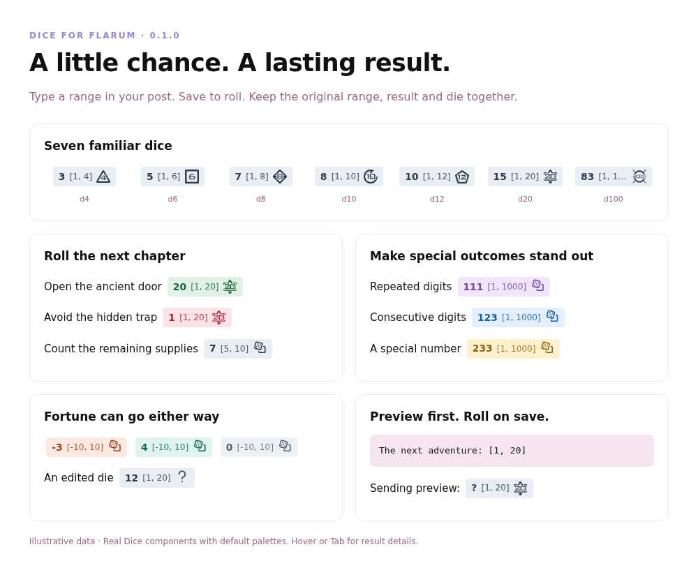
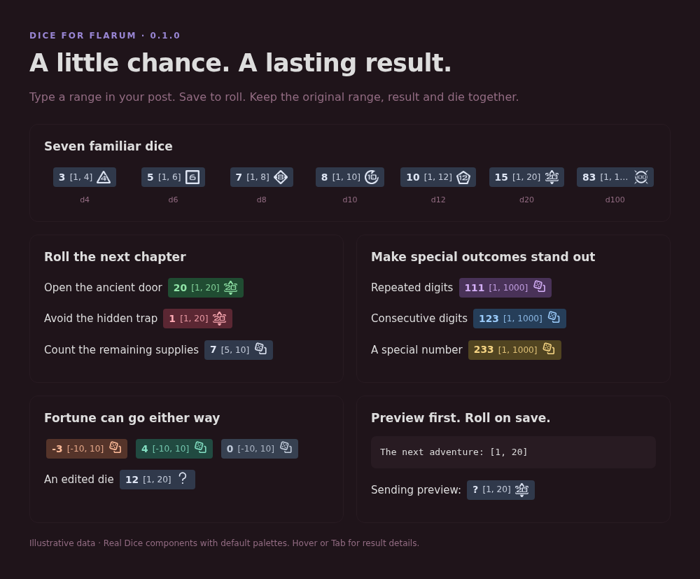
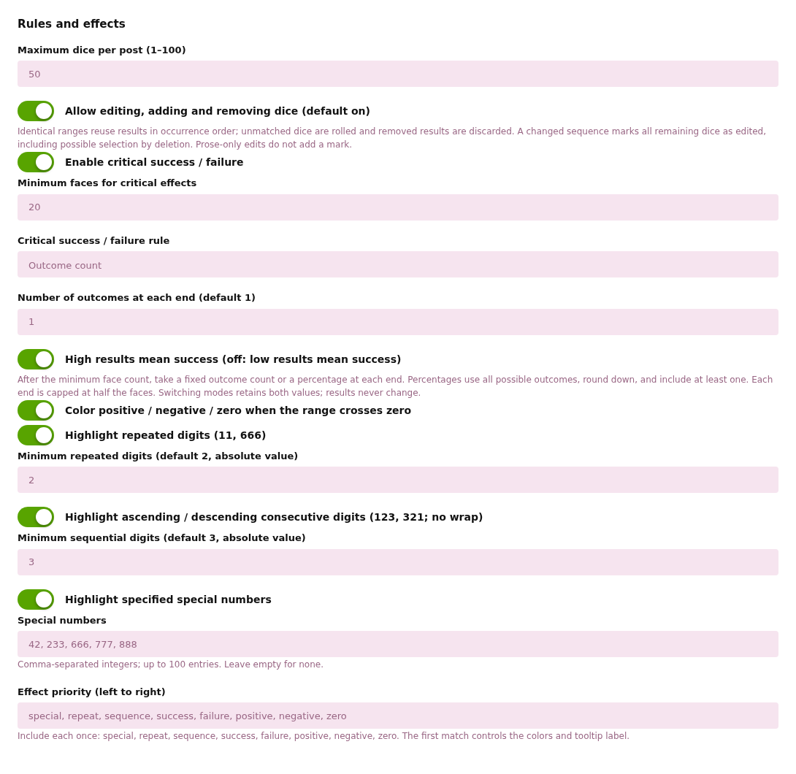
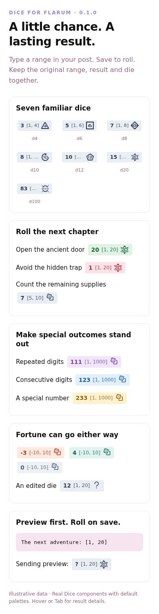

# Dice for Flarum

[简体中文](README.zh-CN.md) · [Configuration](docs/CONFIGURATION.md) · [Technical documentation](docs/TECHNICAL.md)

I recently read quite a lot of TRPGs on nmbxd.com. Since Flarum is a forum theoretically capable of TRPGs, I made this dice.

It's beautiful and highly configurable, the usage is basically the same as nmbxd.

Compatibility, security and possibility of cheating was also considered in its design, while still being user-friendly and fun.

Some standard dice (1d10, 1d20, etc) have special icons, 7 in total. Manually designed and PSed by myself. Also configurable.

This extension is also running on my own deployment: https://forum.monika.love

Notice: This extension was made with massive help of AI, but under careful human supervise and field-tested.

> Anything below this point was written by AI

Add a little chance to your conversations. Type `[1, 20]` in a post and Dice turns it into a persistent, server-generated result, with a matching die icon and optional outcome colors.

**Version 0.1.0.** Available on [Packagist](https://packagist.org/packages/edgeinfinity/flarum-dice).

## Features

- **Roll in ordinary text.** Use inclusive integer ranges such as `[1, 6]`, `[5, 10]` and `[-10, 10]`.
- **Keep the result.** New rolls happen on the server when a post or edit is saved. Refreshing, previewing or clicking never rerolls.
- **Recognize the outcome.** Highlight critical success/failure, positive/negative/zero, repeated or consecutive digits, and custom special numbers.
- **Match your forum.** Customize labels, light/dark colors, seven built-in dice, Font Awesome icons or ordinary image URLs.
- **Handle edits openly.** Unchanged ranges reuse results; changed dice can display an edited marker. Administrators can lock dice editing.
- **Stay readable.** Hover or Tab for a tooltip. Summaries retain the original placeholder. English and Simplified Chinese are included.

## Quick start

    Can I open the ancient door? [1, 20]
    How many supplies remain? [5, 10]
    A change in fortune: [-10, 10]

The editor keeps your text. A new die shows `?` in the sending preview and receives a result after a successful save. Display order: **result → original range → icon**. Code, quoted text and link labels are excluded. Use inline code or escape the opening bracket for literal examples.

The default limit is 50 dice per post (configurable from 1 to 100). Endpoints must be integers between −1,000,000,000 and 1,000,000,000, with minimum ≤ maximum. Equal endpoints are allowed.

## Installation

Requires **Flarum 2.0.2+ in the 2.x series** and **PHP 8.3+ in the 8.x series**. Flarum 1.x is unsupported. No other third-party extension is required.

Run these commands from your Flarum root:

    composer require edgeinfinity/flarum-dice:^0.1.0
    php flarum migrate
    php flarum cache:clear

Enable **Dice** in administration. Back up your database before installation or updates. If you used the repository preview, remove its custom VCS entry with `composer config --unset repositories.edgeinfinity-dice` before switching to the stable constraint.

## Make it your own

Open **Administration → Extensions → Dice** for editing rules, effect priority, labels, icons and palettes. Settings change appearance, not saved results. See the [configuration guide](docs/CONFIGURATION.md).

## Editing and keeping your data

Editing is allowed by default, subject to normal forum permissions. Identical ranges reuse saved results in occurrence order, even when moved. New or changed ranges roll on save; removed dice lose their stored result. Prose-only edits do not reroll. A changed sequence marks every remaining die as edited because deleting an unfavorable result can also select an outcome. The marker signals an edit, not proven cheating.

Administrators can disable dice editing while permitting prose and whitespace edits. Users may still delete and repost if the forum permits it. Dice does not provide independently verifiable fairness or prevent administrators from changing data.

Existing posts are never rolled automatically. Hiding preserves results; permanent deletion removes them. **Disabling, removing or uninstalling retains the result column for reinstallation.** Read [storage and recovery](docs/LIFECYCLE.md) first.

Mobile view

## More information

- [Configuration and appearance](docs/CONFIGURATION.md)
- [Architecture, development and verification](docs/TECHNICAL.md)
- [Storage, editing and recovery](docs/LIFECYCLE.md)
- [Release process](docs/RELEASING.md) · [Changelog](CHANGELOG.md)
- [Report an issue](https://github.com/edgeinfinity1/flarum-dice/issues)

Screenshots use illustrative data rendered by the extension in a browser. Your forum's theme may look different.

## License

[MIT](LICENSE). Included artwork was supplied by the project owner; see [artwork credits](assets/README.md).
