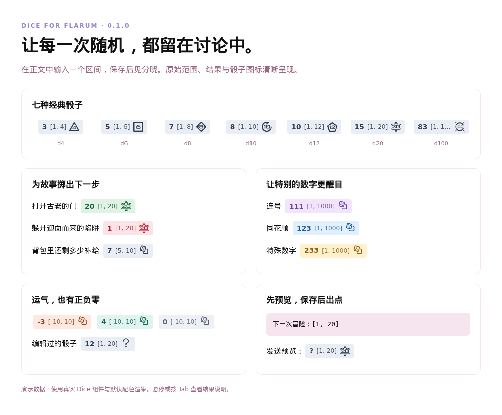
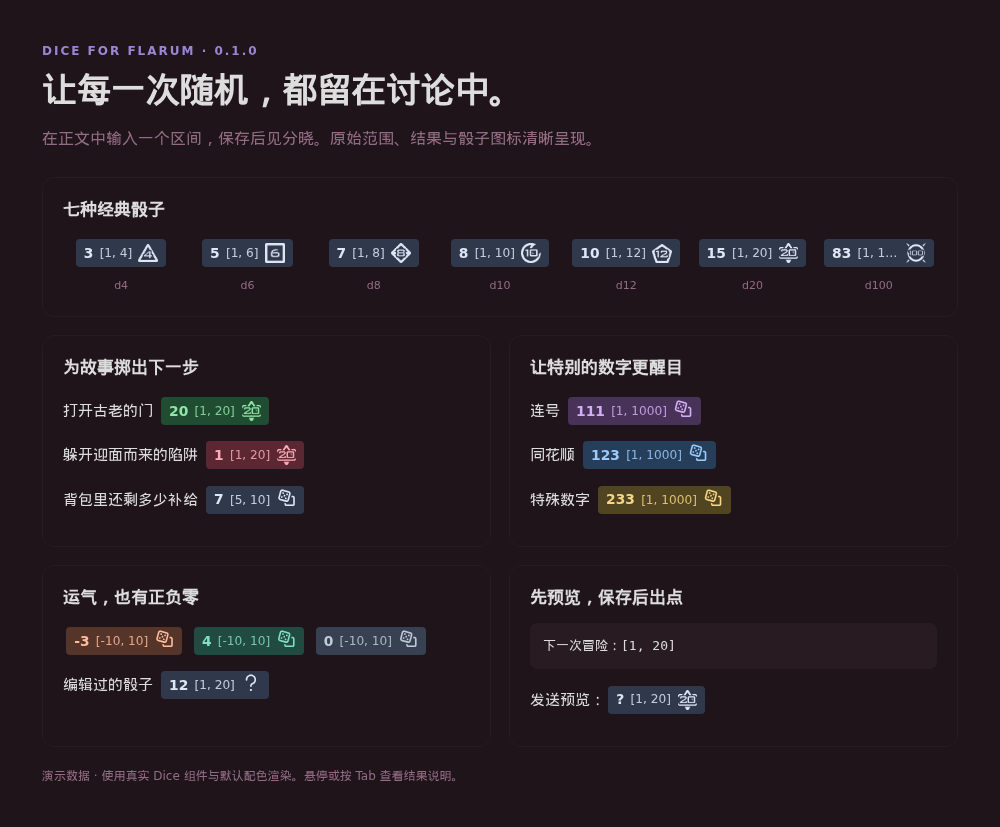
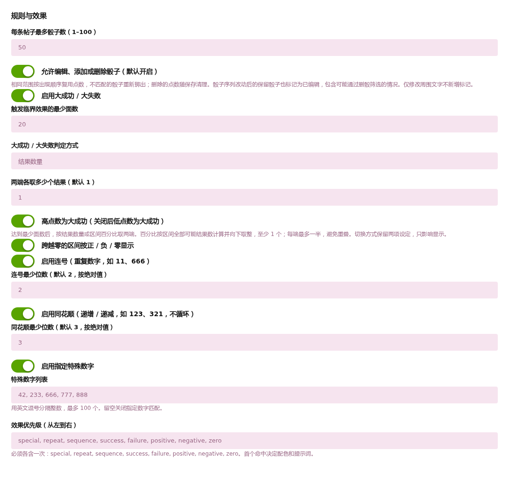
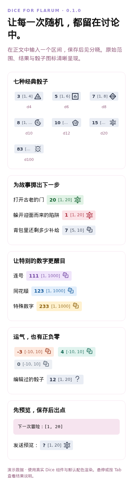

# Flarum 骰子

[English](README.md) · [配置指南](docs/CONFIGURATION.zh-CN.md) · [技术文档](docs/TECHNICAL.zh-CN.md)

近段时间在x岛看了不少跑团, 感觉flarum作为论坛也应该有跑团的潜力, 所以做了这个骰子.

总体来说比较美观, 可配置性也很高, 远比x岛的漂亮. 使用方法和x岛大差不差.

设计的时候在兼容性, 安全性和防作弊上都有比较周全的考虑(当然也保持了轻松好玩).

一些标准骰子(1d10, 1d20等)有特殊的图标, 共七个, 是我自己设计然后PS的. 也可以自行配置.

这个插件也在我自己的论坛上运行: https://forum.monika.love

注意: 大量开发工作由AI完成, 但均由我监管且经过测试.

> 下面的内容就都是AI写的了

为讨论增添一点随机乐趣。在帖子中输入 `[1, 20]`，Dice 就会把它变成由服务端生成并保存的结果，搭配骰子图标和自定义配色。

**版本 0.1.0。** 已在 [Packagist](https://packagist.org/packages/edgeinfinity/flarum-dice) 发布。

## 主要功能

- **直接在正文掷骰。** 支持包含两端的整数区间，如 `[1, 6]`、`[5, 10]`、`[-10, 10]`。
- **结果持久保存。** 服务端仅在保存帖子或编辑时生成新结果；刷新、打开预览或点击骰子都不会重掷。
- **让特殊结果更醒目。** 支持大成功／大失败、跨零区间正负零、连号、同花顺和自定义特殊数字。
- **融入论坛风格。** 可配置提示词、浅深色配色、七种内置骰子，也可使用 Font Awesome 或普通图片 URL。
- **明确展示编辑行为。** 相同范围复用结果，修改骰子可显示编辑标记；管理员也可禁止编辑骰子。
- **兼顾阅读和预览。** 悬停或键盘 Tab 查看说明；摘要保留原始占位符。内置英文和简体中文。

## 快速上手

    我能打开这扇古老的门吗？[1, 20]
    还剩多少补给？[5, 10]
    运气的变化：[-10, 10]

输入框保留原文，发送预览中的新骰子显示 `?`，保存成功后才出现结果。显示顺序是 **结果 → 原始区间 → 图标**。代码、引用和链接标签不生成骰子；语法示例请使用行内代码或转义左中括号。

默认每帖最多 50 个骰子，后台可设为 1–100。端点必须是 −1,000,000,000 至 1,000,000,000 之间的整数，最小值不得大于最大值；允许两端相同。

## 安装

需要 **Flarum 2.0.2 及以上的 2.x 版本**、**PHP 8.3 及以上的 8.x 版本**。不支持 Flarum 1.x，不依赖其它第三方扩展。

在 Flarum 根目录执行：

    composer require edgeinfinity/flarum-dice:^0.1.0
    php flarum migrate
    php flarum cache:clear

然后在后台启用 **Dice**。安装或更新前请备份数据库。此前使用仓库预览版的用户，请先运行 `composer config --unset repositories.edgeinfinity-dice` 移除自定义 VCS 项，再改用正式版本约束。

## 自定义外观与规则

进入 **管理后台 → 扩展 → Dice**，设置编辑规则、效果优先级、提示词、图标和配色。修改设置只改变展示，不改变已保存的点数。详见[配置指南](docs/CONFIGURATION.zh-CN.md)。

## 编辑与数据保留

默认允许编辑，仍受论坛原有权限约束。相同范围按出现顺序复用已保存的结果，移动位置也不会重掷；新增或变化的范围在保存时出点，被删骰子的结果随之清除。仅改普通文字不会重掷。序列变化后，所有剩余骰子都会标记已编辑，因为删除不利结果也可能产生选择偏差；标记提示编辑行为，不代表认定作弊。

管理员可禁止修改骰子，同时允许修改叙述与空白。若论坛允许，用户仍可删帖重发；本插件不提供独立于管理员的可验证公平性，也不阻止管理员直接修改数据。

旧帖不会自动补掷。隐藏帖子保留结果，永久删除一并清除。**禁用、移除或后台卸载仍保留结果字段，方便重装恢复。** 操作前请阅读[存储与恢复](docs/LIFECYCLE.zh-CN.md)。

手机视图

## 更多资料

- [配置与外观](docs/CONFIGURATION.zh-CN.md)
- [架构、开发与验证](docs/TECHNICAL.zh-CN.md)
- [存储、编辑与恢复](docs/LIFECYCLE.zh-CN.md)
- [发布流程](docs/RELEASING.zh-CN.md) · [更新记录](CHANGELOG.md)
- [反馈问题](https://github.com/edgeinfinity1/flarum-dice/issues)

截图使用浏览器中由插件实际渲染的演示数据；你站点的主题外观可能不同。

## 许可

[MIT](LICENSE)。骰子素材由项目所有者提供，见[素材说明](assets/README.md)。
