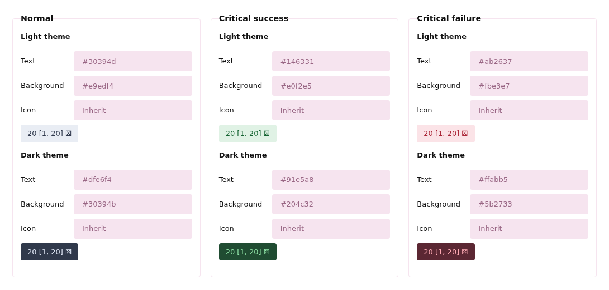
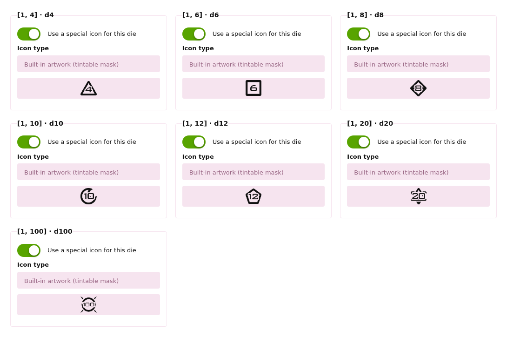

# Configuration and appearance

[简体中文](CONFIGURATION.zh-CN.md) · [Introduction](../README.md)

Open Administration → Extensions → Dice. Settings change appearance, never saved results. Restore defaults changes the form; save to apply.

| Setting | Default | Meaning |
| --- | --- | --- |
| Dice per post | 50 | Accepts 1–100 |
| Allow editing / edited marker | On / on | Reuse identical ranges FIFO; mark changed sequences |
| Critical effects | On, minimum 20 faces | Faces = maximum − minimum + 1 |
| Critical mode | Outcome count, 1 | One result at each end |
| Alternative percentage | 5% | Retained when switching; accepts 0.01–50% |
| Success direction | High | Turn off for low-is-success systems |
| Repeated digits | On, minimum 2 | 11, 666; absolute value |
| Consecutive digits | On, minimum 3 | 123, 321; no wrapping |
| Special numbers | 42, 233, 666, 777, 888 | Up to 100 integers |

A percentage band is `floor(faces × percentage / 100)`, with at least one outcome. Both modes cap each end at half the faces to prevent overlap. For `[1, 100]`, 5% marks 1–5 and 96–100; count 1 marks only 1 and 100. Single-outcome ranges do not meet the minimum critical face count.

Positive/negative/zero effects apply to ranges crossing zero. Default priority: `special, repeat, sequence, success, failure, positive, negative, zero`. Include every key once; the first match supplies the colors and tooltip label. No match uses the normal palette.

## Labels and colors

Effect labels accept up to 40 plain-text characters; empty uses the current language. Each palette has light/dark text, background and icon colors. Use hex, optionally with alpha. Empty text/background inherit normal dice colors; an empty icon follows the text.

## Icons

Exact `[1, N]` for N = 4, 6, 8, 10, 12, 20 and 100 use built-in tintable artwork. Each can be disabled or replaced with Font Awesome or an image URL. Ordinary images retain their colors; masks/fonts follow the palette. Failed images fall back to the generic icon.

Generic/edited defaults are `far fa-dice` / `far fa-question`. These defaults use a solid-weight fallback with Font Awesome Free; `fas fa-dice` / `fas fa-question` are explicit Free-compatible alternatives. Other icons need their corresponding font on your forum.

Image URLs must be site-root-relative or HTTP(S) without credentials. Data URLs, protocol-relative URLs and scripts are rejected, including inactive configurations. Images load in the browser with no referrer; no upload endpoint or server-side fetch is added.

Hover or Tab for range/result/effect tooltips. Pointer clicks do not pin them or reroll. Editing previews reuse known ranges and leave unmatched ranges pending; inputs and summaries keep raw placeholders. See [lifecycle](LIFECYCLE.md) for editing and old-setting compatibility.
