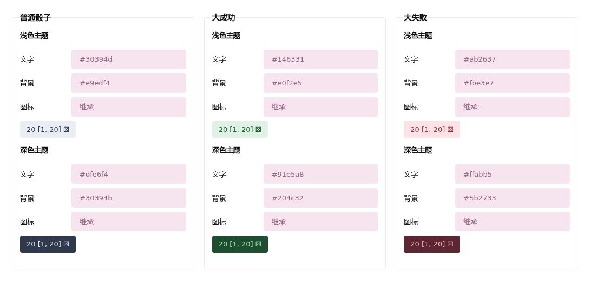
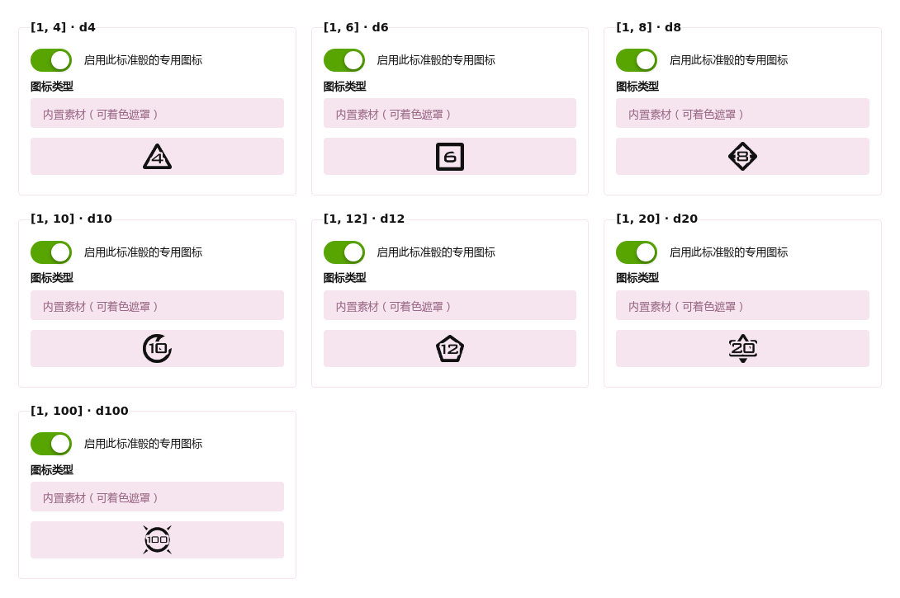

# 配置与外观

[English](CONFIGURATION.md) · [返回介绍](../README.zh-CN.md)

进入管理后台 → 扩展 → Dice。设置只改变展示，不改变保存的点数。“恢复默认”只修改表单，保存后生效。

| 设置 | 默认值 | 说明 |
| --- | --- | --- |
| 每帖骰子上限 | 50 | 可设为 1–100 |
| 允许编辑／编辑标记 | 开启／开启 | 相同范围按顺序复用，变化序列加标记 |
| 大成功／大失败 | 开启，最少 20 面 | 面数 = 最大值 − 最小值 + 1 |
| 判定方式 | 结果数量，两端各 1 个 | 仅两端极值 |
| 备用百分比 | 5% | 切换时保留，可设 0.01–50% |
| 成功方向 | 高点成功 | 关闭改为低点成功 |
| 连号（重复数字） | 开启，最少 2 位 | 如 11、666，按绝对值判断 |
| 同花顺（连续数字） | 开启，最少 3 位 | 如 123、321，不循环 |
| 特殊数字 | 42、233、666、777、888 | 最多 100 个整数 |

百分比按 `floor(面数 × 百分比 / 100)` 计算，至少 1 个结果；两种方式每端最多取面数的一半，避免重叠。`[1, 100]` 的 5% 覆盖 1–5、96–100；数量 1 只覆盖 1、100。单结果区间不满足大成功／大失败最少面数。

正负零效果只用于跨零区间。默认优先级是 `special, repeat, sequence, success, failure, positive, negative, zero`，每项必须出现一次；仅第一个命中项决定配色和提示词，无匹配采用普通配色。

## 提示词与配色

每个效果名称最多 40 个纯文本字符，留空使用当前语言。每套配色含浅色／深色的文字、背景及图标色，支持十六进制与透明度。文字／背景留空继承普通配色；图标留空跟随文字。

## 图标

精确 `[1, N]` 且 N 为 4、6、8、10、12、20、100 时使用内置可着色素材。可逐项关闭或改为 Font Awesome、图片 URL。普通图片保留原色，遮罩／字体跟随配色；加载失败回退通用图标。

通用／编辑默认 `far fa-dice`／`far fa-question`，在 Font Awesome Free 下为这两个默认图标回退到实心字重；也可明确使用 `fas fa-dice`／`fas fa-question`。其它图标需要对应字体。

图片只接受站点根路径或不含凭据的 HTTP(S) 地址；未启用的配置也拒绝 data URL、协议相对 URL 和脚本。浏览器请求不发送 referrer；插件不新增上传接口或服务端抓取。

悬停或 Tab 查看范围／结果／效果，点击不固定提示也不重掷。编辑预览复用已知范围，其余待掷；输入框和摘要保留原文。编辑和旧设置兼容见[生命周期](LIFECYCLE.zh-CN.md)。
